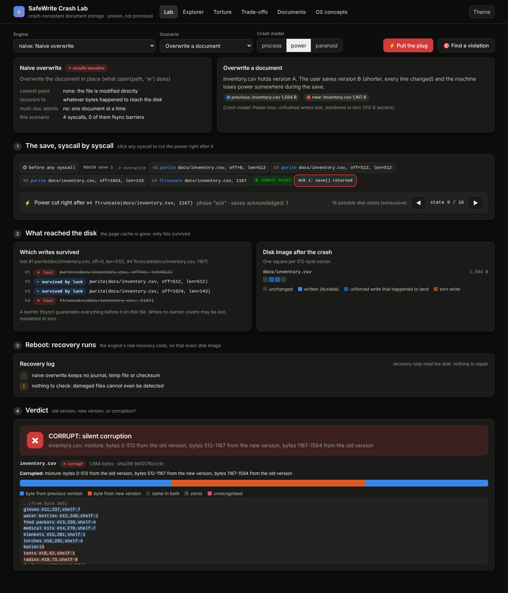
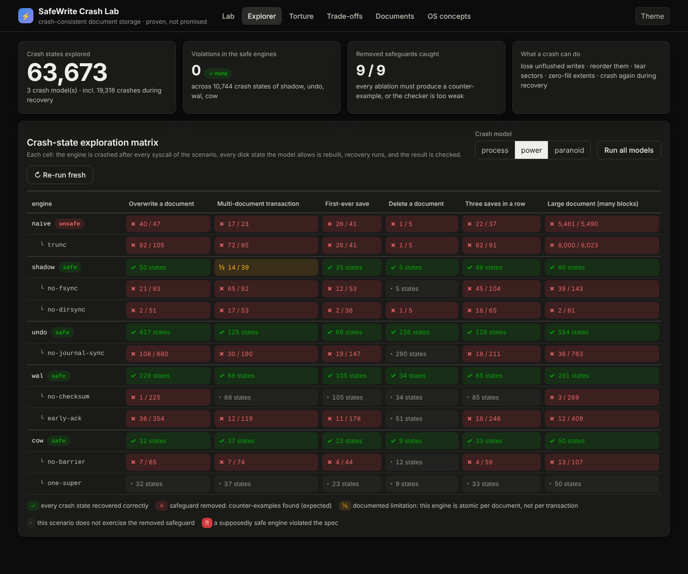
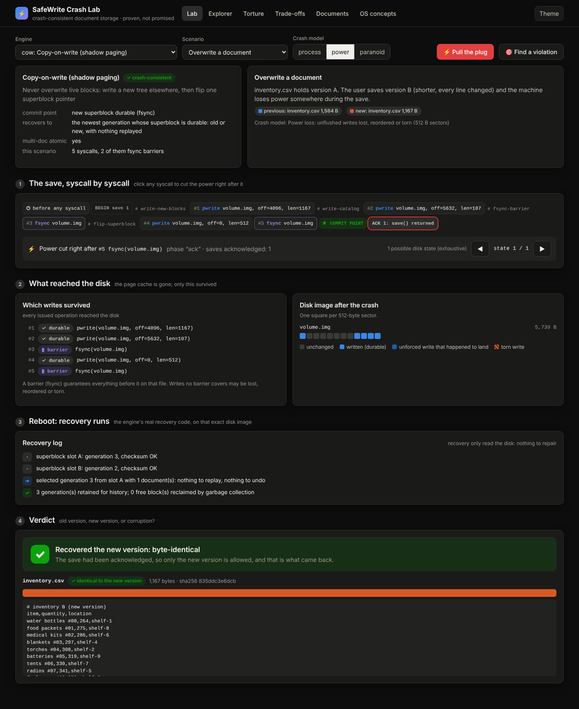
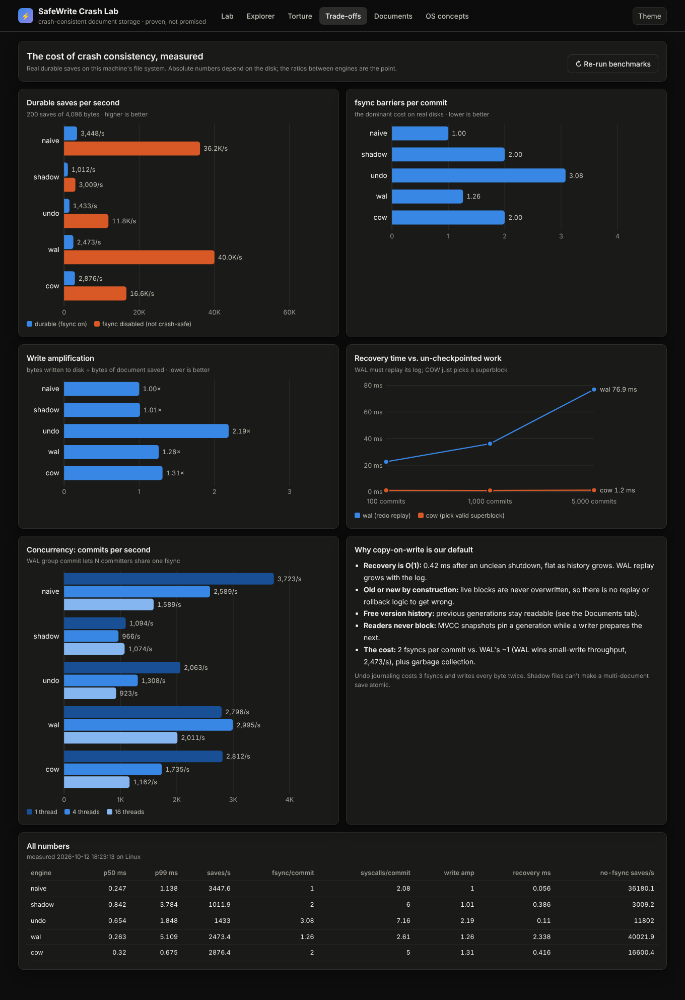
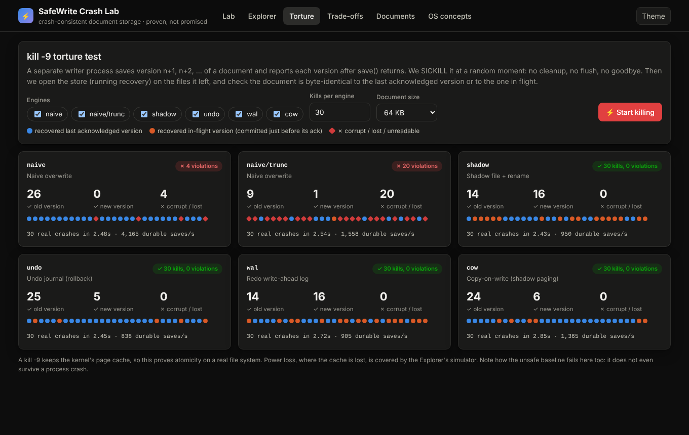
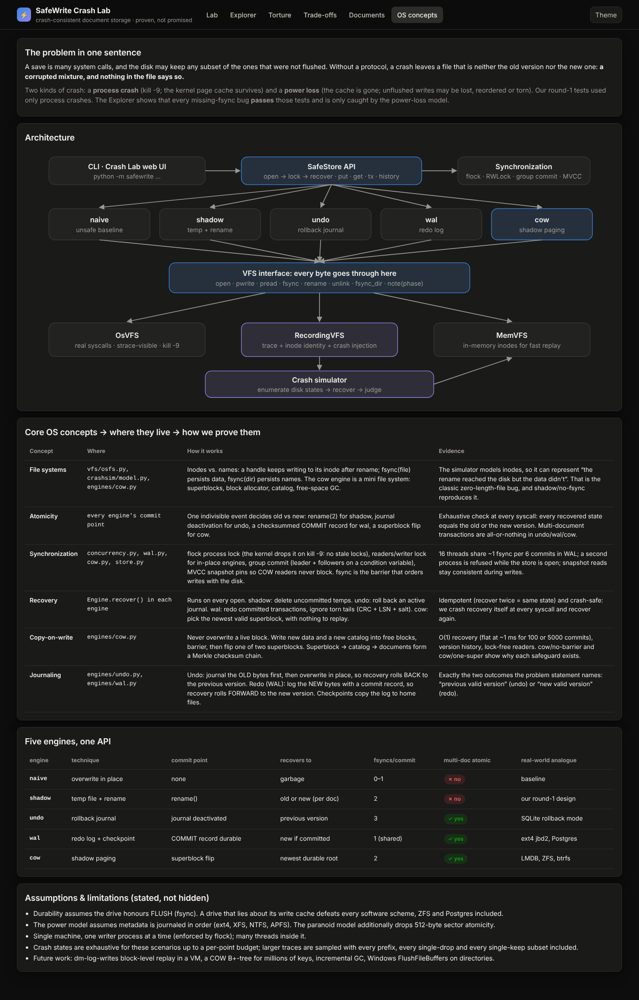

# SafeWrite: crash-consistent document storage, *proven, not promised*

**Kernel Ops hackathon · OSH021 · Memory, Storage & File Systems · Team VAT**
Tanush Keshri · Vyom Singh · Abhishek Kumar Maurya

> A document store with **four interchangeable crash-recovery engines** (temp file + rename,
> undo journal, redo write-ahead log, copy-on-write shadow paging) and a **power-loss
> simulator** that enumerates *every disk state a crash can leave behind*, at *every
> system call*, then runs the real recovery code on each one and proves the document
> always comes back as the **previous valid version or the new valid version, never a
> corrupted mixture.**



<p align="center"><i>The Crash Lab. A naive in-place save loses power after its 2nd write: the file is
bytes 0–1024 of the new version followed by the old version's tail, and nothing flags the damage.
Switch the engine to <code>cow</code> and the same crash recovers a byte-identical version.</i></p>

---

## Results at a glance

| Evidence | Result |
|---|---|
| Crash states explored (3 crash models × 6 scenarios × 13 engine variants, incl. crashes *during* recovery) | **63,673** in ~25 s |
| Violations in the four safe engines | **0** of 10,744 states |
| Deliberately removed safeguards (ablations) caught with a concrete counter-example | **9 / 9** |
| Real `kill -9` torture on ext4 (safe engines) | **0** corruptions |
| Real `kill -9` torture, `naive/trunc` (what `open(path, "w")` does) | corrupts in **~50%** of kills (empty or truncated files) |
| Missing-`fsync` bugs found by `kill -9` testing alone | **0**: they only appear under power loss, which is why we built the simulator |
| Lost-update race, 8 threads × 50 increments | unsynchronized ≈ **50/400**; `store.update()` **400/400** |
| COW recovery time, 100 → 5,000 un-checkpointed commits | **~1 ms flat** (WAL replay: 23 → 77 ms) |
| WAL group commit at 16 threads | **6.9 commits share one fsync** |
| Tests | 53 automated tests, CI on Linux · macOS · Windows × Python 3.9 / 3.12 |

Zero dependencies: Python ≥ 3.9 standard library only. Runs offline.

---

## 60-second quick start

```bash
git clone https://github.com/VMS2907/KernelOps && cd KernelOps

python -m safewrite serve          # the Crash Lab → http://127.0.0.1:8765
python -m safewrite demo           # narrated terminal walk-through (real crashes, live)
python -m unittest discover -s tests -t .
```

<details>
<summary><b>Everything the CLI can do</b></summary>

```bash
# a real store on your disk
python -m safewrite init  mystore --engine cow        # naive | shadow | undo | wal | cow
python -m safewrite put   mystore inventory.csv --file a.csv
python -m safewrite get   mystore inventory.csv
python -m safewrite history mystore inventory.csv     # cow keeps old generations
python -m safewrite verify  mystore                   # scrub every checksum

# REALLY kill the process at any syscall of a save, then recover
python -m safewrite crash   mystore inventory.csv --file b.csv --list     # numbered syscall plan
python -m safewrite crash   mystore inventory.csv --file b.csv --at 4     # os._exit(77) before syscall 4
python -m safewrite recover mystore --key inventory.csv --out out.csv     # prints what recovery did

# the proof
python -m safewrite trace   wal --scenario transfer   # an engine's exact syscall protocol
python -m safewrite explore --examples 1              # the full crash-state matrix + counter-examples
python -m safewrite torture --trials 200              # real kill -9 loop
python -m safewrite race                              # lost-update race vs. synchronization
python -m safewrite bench                             # latency, fsyncs, write amplification, recovery
```
</details>

---

## What we built

```
               ┌───────────────────────────────────────────────────────────┐
  CLI / Web UI │ SafeStore: open → flock → recover · put · get · tx · history │
               └──────────────────────────────┬────────────────────────────┘
     ┌────────────┬────────────┬──────────────┼─────────────┬──────────────┐
     │   naive    │   shadow   │     undo     │     wal     │     cow      │
     │  baseline  │ tmp+rename │ rollback jnl │ redo log    │ shadow paging│
     └────────────┴────────────┴──────┬───────┴─────────────┴──────────────┘
              synchronization: flock · RWLock · group commit · MVCC pins
                                      │ every byte goes through
                ┌─────────────────────┴──────────────────────┐
                │ VFS: open pwrite pread fsync rename unlink │
                │      fsync_dir ftruncate · note(phase)     │
                └───┬──────────────────┬─────────────────┬───┘
               OsVFS (real        RecordingVFS       MemVFS (fast
               syscalls)          (trace + inodes    in-memory replay)
                                  + crash injection)
                                       │
                         Crash simulator: enumerate post-crash disks
                         → real recovery → OLD / NEW / CORRUPT / LOST …
```

### Five engines, one API

| Engine | Technique | Commit point | After a crash, recovers to | fsyncs / commit | Multi-doc atomic |
|---|---|---|---|---|---|
| `naive` | overwrite in place (**unsafe baseline**) | none | whatever bytes landed | 0 | ✗ |
| `shadow` | temp file + fsync + `rename` (our round-1 design, hardened) | `rename()` | old or new, per document | 2 | ✗ (shown) |
| `undo` | rollback journal (SQLite style) | journal deactivated | **the previous version** | 3 | ✓ |
| `wal` | redo log + checkpoints + group commit (ext4 jbd2 / Postgres style) | COMMIT record durable | **the new version** if committed | ~1 (shared) | ✓ |
| **`cow`** (default) | copy-on-write, dual superblocks, Merkle checksums (LMDB / ZFS / btrfs style) | superblock flip | newest durable generation, nothing replayed | 2 | ✓ + history + lock-free readers |

### The crash model (what "every crash" means)

* `fsync(file)` and `fsync(dir)` are barriers. Namespace operations persist in order (journaled metadata).
* Any **unflushed write may be lost, kept, or reordered**, and one may be **torn**: a prefix, a suffix or a
  *hole* of its sectors persists, or only the size grows and the data reads back as zeros.
* `process` = `kill -9` (page cache survives) · `power` = 512-byte atomic sectors · `paranoid` = no sector atomicity.
* Every crash point × every allowed disk state → rebuild the image → run the engine's **real** recovery →
  check *atomicity* (old or new), *durability* (acknowledged ⇒ new), *idempotence* (recover twice = same),
  and **crash the recovery itself** at every step.

This is the methodology of the OSDI research tools **ALICE** (2014) and **CrashMonkey** (2018), applied to our own engines.

### Ablations: why every line of the protocol exists

| Variant | Safeguard removed | What the explorer finds |
|---|---|---|
| `shadow/no-fsync` | `fsync(tmp)` before `rename` | rename lands before the data → 0-byte file, **old version destroyed** (the 2009 ext4 bug) |
| `shadow/no-dirsync` | `fsync(dir)` after `rename` | acknowledged save silently **rolls back** |
| `undo/no-journal-sync` | journal `fsync` before overwriting | torn document with nothing to roll back to |
| `wal/no-checksum` | record CRCs | a log record whose middle sector never landed is **replayed as committed garbage** |
| `wal/early-ack` | log `fsync` before acknowledging | acknowledged commits vanish |
| `cow/no-barrier` | `fsync` before the superblock flip | superblock points at blocks that never reached the disk |
| `cow/one-super` | the second superblock slot | a torn superblock leaves **no valid root** (paranoid model) |



---

## The Crash Lab (web UI)

`python -m safewrite serve`. Zero dependencies, works offline, light and dark themes.

| Tab | What it shows |
|---|---|
| **Lab** | Pick engine × scenario × crash model, click any syscall to cut the power there, step through every possible post-crash disk, watch recovery narrate itself, and get a byte-provenance verdict. |
| **Explorer** | The proof matrix, streamed live. Click a cell for outcome breakdowns, per-crash-point bars and counter-examples, then **Open in Lab** at that exact state. |
| **Torture** | Live real `kill -9` loop per engine with a dot per crash. |
| **Trade-offs** | Measured saves/s, fsyncs/commit, write amplification, recovery scaling, concurrency. |
| **Documents** | A *real* store on disk: edit, save, browse/restore versions, and **Save & kill -9 mid-save** (a child process is killed for real, then recovery runs). |
| **OS concepts** | Concept → code → evidence mapping, architecture, assumptions and limitations. |

| | |
|---|---|
|  |  |
|  |  |

---

## Repository layout

```
safewrite/
  vfs/            base.py (the interface) · osfs.py (real syscalls) · memfs.py · recording.py
  engines/        naive.py · shadow.py · undo.py · wal.py · cow.py · base.py (the contract)
  crashsim/       model.py (persistence model + enumeration) · explorer.py (record/recover/judge)
                  scenarios.py · provenance.py (which byte came from which version)
  concurrency.py  RWLock · ProcessLock (flock / msvcrt) · GroupCommit
  store.py        SafeStore public API (lock → recover on open, transactions, update)
  torture.py      real kill -9 harness        race.py   lost-update demo
  bench.py        measurements                demo.py   narrated terminal demo
  cli.py          python -m safewrite …       server/   Crash Lab (stdlib http.server + vanilla JS)
tests/            54 tests: formats, VFS equivalence, engines, exhaustive crashes, real crashes, faults, concurrency, API
results/          explore.json · bench.json (pre-generated, loaded by the UI)
docs/             DESIGN.md · JUDGE_QA.md · DEMO_SCRIPT.md · PLAN.md · VIDEO_PLAN.md · img/ · media/
video/            the launch film, built from code (footage capture, motion graphics, synthesized score)
```

## Documents

* **[docs/DESIGN.md](docs/DESIGN.md)**: the design document, covering all seven required deliverables in depth.
* **[docs/LIVE_DEMO.md](docs/LIVE_DEMO.md)**: kill a real program mid-save on your own laptop and open the result in Notepad (copy-paste commands for Windows and macOS).
* **[docs/DEMO_SCRIPT.md](docs/DEMO_SCRIPT.md)**: the 7-minute stage demo, click by click, with a fallback plan.
* **[docs/JUDGE_QA.md](docs/JUDGE_QA.md)**: the questions we expect from judges, answered.
* **[docs/PLAN.md](docs/PLAN.md)**: the build plan and gap analysis of our round-1 submission.
* **[docs/Team_VAT_SafeWrite_Final_Round.pptx](docs/Team_VAT_SafeWrite_Final_Round.pptx)**: the final-round slide deck (Kernel Ops template).
* **[docs/media/SafeWrite_launch.mp4](docs/media/SafeWrite_launch.mp4)**: the 100-second launch film: real product footage, real CLI output, original score. Built from code: [video/README.md](video/README.md); storyboard and voiceover script: [docs/VIDEO_PLAN.md](docs/VIDEO_PLAN.md).

## Honest limitations

Durability assumes the drive honours flush requests (no software can survive a disk that lies about
its cache). The power model assumes journaled metadata (ext4, XFS, NTFS, APFS). One writer process at a
time (enforced with `flock`), many threads inside it. Crash states are exhaustive per crash point up
to a budget; larger traces are sampled, always including every prefix, every single-drop and every
single-keep subset. Details in [DESIGN.md §6](docs/DESIGN.md#6-trade-offs-limitations-and-future-work).

MIT licence.
