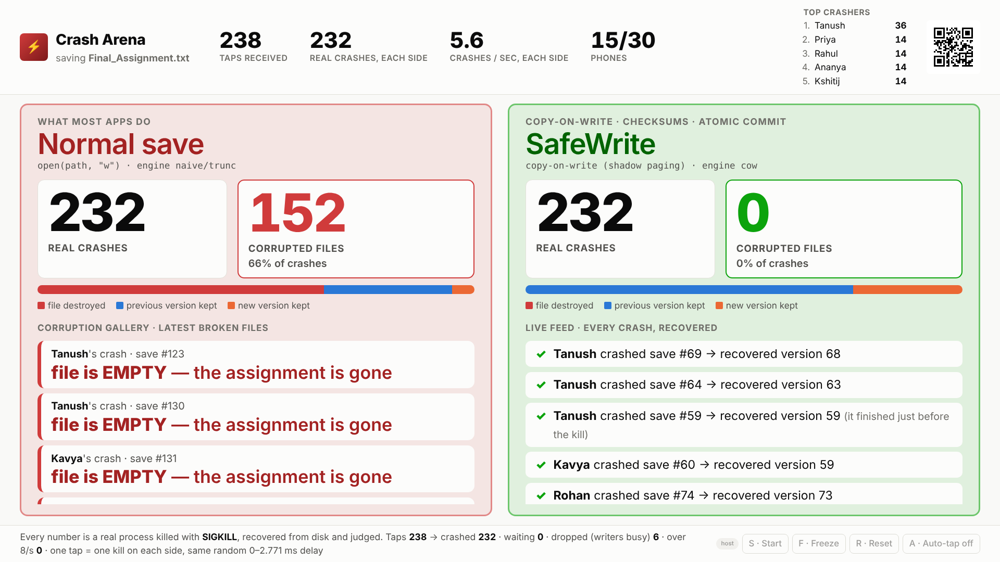
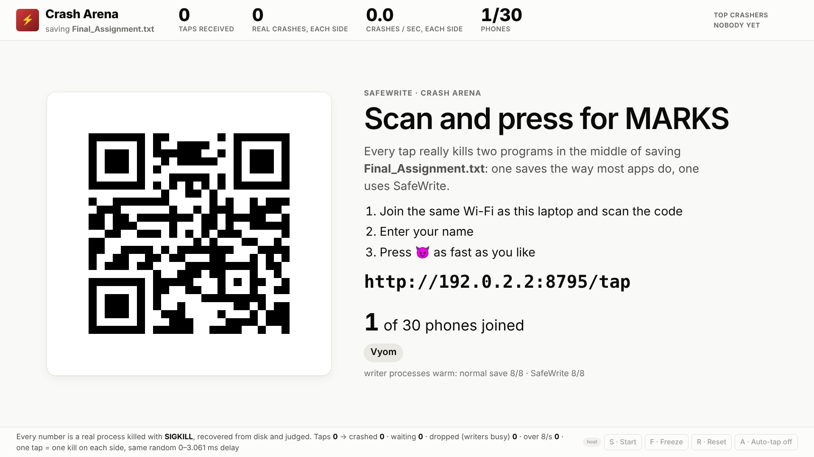
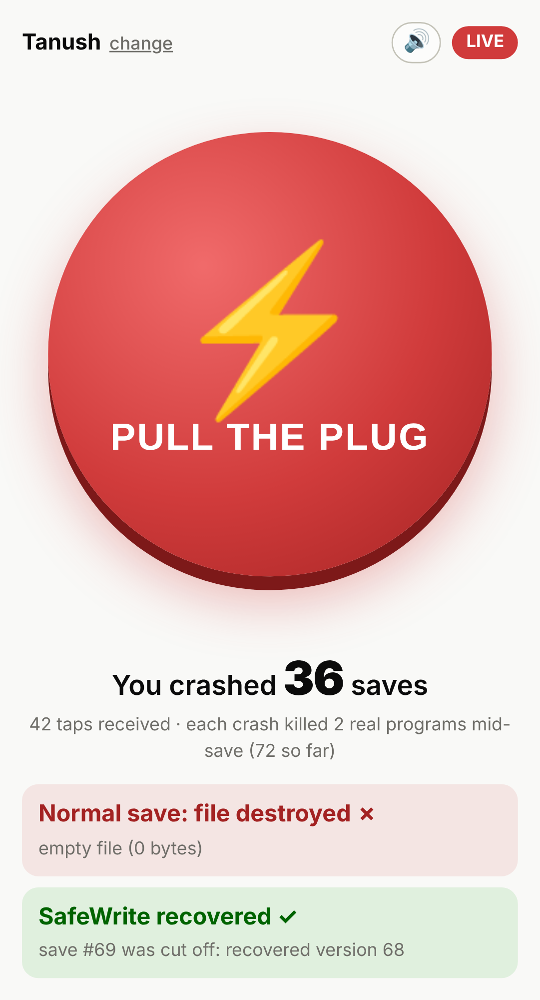

# Crash Arena: stage runbook

> The audience crashes SafeWrite live from their phones. Every tap **really kills** two writer
> processes in the middle of saving `Final_Assignment.txt`, one saving the way most apps do and
> one using SafeWrite. Each phone has one giant **😈 Press for MARKS** button that plays a "FAAAH"
> on every tap, and the projector counts what survived. Up to **60 phones** can play at once (`--max-phones` to change).



| | |
|---|---|
|  |  |

---

## 1. What happens on one tap

1. The phone POSTs the tap. The server counts it and puts it in a fair queue. It never waits for a crash.
2. A **crash lane** takes one *warm* writer from each side:
   * **left**, `naive/trunc`: `open(path, "w")` then write, which is what most programs do;
   * **right**, `cow`: SafeWrite's copy-on-write engine.

   Both writers already have their store open and are waiting for a "go" line on stdin.
3. Both get "go" and start saving version n+1, n+2, ... in a loop, exactly the torture-test writer.
   The lane waits until each has acknowledged one save, so both are mid-way through their save loop.
4. **One** random delay is drawn, then both are killed **back to back**: `SIGKILL` on Linux/macOS,
   `TerminateProcess` on Windows. Who dies first alternates on every tap.
5. Each store is opened in the server process, which runs the engine's real recovery, and the
   torture harness's `_judge` classifies the file:

   | Verdict | Meaning | Counted as |
   |---|---|---|
   | `OLD` | byte-identical to the last acknowledged version | survived |
   | `NEW` | byte-identical to the version being written (it finished just before the kill) | survived |
   | `EMPTY` | 0 bytes: `open(path, "w")` had truncated it | **corrupted** |
   | `TRUNCATED` | only a prefix of the file survived | **corrupted** |
   | `CORRUPT` | a mixture matching no version, described byte by byte | **corrupted** |
   | `LOST` / `DETECTED` / `UNRECOVERABLE` | a saved version vanished / damage caught / store unreadable | **corrupted** |

6. A fresh writer is started in the background to replace each dead one.

**Honesty rules, enforced in code and in `tests/test_arena.py`:**

* A number on the projector is a count of verdicts. There is no animation, interpolation or estimate.
* Every tap is accounted for: received = crashed + waiting + dropped (busy) + over the rate limit +
  not run (frozen) + failed. The footer of the projector shows all of them.
* One crashed tap = exactly one kill on each side, with the same delay. The test suite checks this
  for every tap.
* Auto-tap crashes are labelled **AUTO** in the feed and counted separately from phone taps.
* `GET /api/arena/export` (host only) downloads every crash record, including slot, delay, kill
  order and the judge's text.

The on-screen name `Final_Assignment.txt` is framing. The real document is the torture harness's
versioned file (`torture.doc`: a header plus a deterministic random body of 32–96 KB). Each
version has a different length, so a truncation or a mixture can never pass as valid.

---

## 2. Two ways to run it

| | **10-volunteer mode** | **Whole-room mode** |
|---|---|---|
| Who taps | ~10 people called to the front, or 10 phones passed around | up to 30 phones in the room (the cap) |
| Network | **a phone hotspot is enough** | a Wi-Fi router (travel router), or venue Wi-Fi without client isolation |
| Command | `python -m safewrite arena --pool 8 --max-phones 10` | `python -m safewrite arena --pool 8` |
| Measured tap → verdict (4-core laptop) | p95 **1.1 s** | p95 **4.0 s** (30 phones hammering) |
| Best for | reliability, small rooms, a guaranteed demo | a big "wow" moment |

**10-volunteer mode is a first-class option, not a fallback.** It needs no infrastructure: one phone
runs a hotspot, and the laptop and volunteers join it. Android hotspots usually allow 8–10 devices
(some allow more in the hotspot settings), Windows Mobile Hotspot allows 8, and an iPhone Personal
Hotspot about 5. With 10 people hammering the button, each tap becomes a verdict within about a
second. That is easy to narrate ("Priya, look up: you just destroyed an assignment").

**Whole-room mode** needs a network where 30 phones can reach the laptop. A phone hotspot
cannot take that many. A cheap travel router (any model, no internet needed, AP/client isolation
off) is the reliable choice. Venue Wi-Fi often blocks phone-to-laptop traffic, so test it first
(§3).

---

## 3. Before the day

* **Laptop on the charger.** Set the power plan to High performance (Windows) or run `caffeinate -d`
  (macOS). Crash throughput is CPU-bound (§7), and a laptop on battery throttles.
* Run the suite once: `python -m unittest discover -s tests -t .`. All tests should be OK.
* Run the self-test (2 minutes, no phones needed):
  `python tools/arena_load.py --phones 10 --seconds 30`. Every line must end in `OK`.
* **Rehearse the network with two real phones** on the exact Wi-Fi or hotspot you will use. If a
  phone cannot open the page, see §4 (firewall) and §9.
* Turn off VPNs. Quit Docker, VirtualBox and WSL if you can: they add network adapters, and the
  arena may pick one of them for the QR code (fix: `--url-host`).
* Turn off notifications and set the display to never sleep.

## 4. Network and firewall

**Phone hotspot (10-volunteer mode).** Turn on the hotspot on a phone that is *not* tapping. Connect
the laptop to it, then the volunteers. Mobile data can be off: nothing ever goes to the internet.

**Travel router or venue Wi-Fi (whole room).** Connect the laptop. On Windows, set this network to
**Private** (Settings → Network → the Wi-Fi → Network profile type → Private).

**Windows firewall.** The first start shows a firewall prompt: tick **Private networks** and click
**Allow access**. If phones still cannot connect, run this once in an *administrator* PowerShell:

```powershell
New-NetFirewallRule -DisplayName "SafeWrite Arena" -Direction Inbound -Protocol TCP -LocalPort 8765 -Action Allow -Profile Private
```

**macOS.** If asked "Do you want the application Python to accept incoming network connections?",
click **Allow**. **Linux** with ufw: `sudo ufw allow 8765/tcp`.

**Check from a phone before going on stage:** open `http://<laptop-address>:8765/tap`. If the join
page loads, the network works.

## 5. Start it

```bash
cd KernelOps
python -m safewrite arena --pool 8 --max-phones 10         # 10-volunteer mode (phone hotspot)
python -m safewrite arena --pool 8                         # whole-room mode (up to 30 phones)
```

The terminal prints the addresses, and **the projector page opens in your browser by itself**:

```
SafeWrite Crash Arena: warming up writers ...

  PHONES open:       http://192.168.43.17:8765/tap
  PROJECTOR (host):  http://127.0.0.1:8765/arena?host=Xk3v9QpL2aRm
  host token:        Xk3v9QpL2aRm    (projector keys: S start · F freeze · R reset · A auto-tap)
  phones:            up to 30 (a phone idle for a minute gives its seat to a newcomer)

  left  (normal save): naive/trunc   right (SafeWrite): cow
  writers:           8 per side, warm  ·  64 KB document  ·  kill delay 0-2.8 ms
  queue:             500 taps max, 3 waiting per phone  ·  8 taps/s per phone  ·  auto-tap 10/s

  Ctrl+C stops the arena, kills every writer and deletes its temp stores.
```

* Press **F11** for full screen. The QR code and the phone URL are on the projector.
* The page removes the token from the address bar as soon as it loads, and a cookie keeps your
  browser the host. Nobody can read the token off the projector.
* If the QR code shows a wrong address (it should match your Wi-Fi address), restart with
  `--url-host 192.168.x.y`. The terminal lists the other addresses it found.
* **Only the laptop controls the arena.** Phones get the tap page and the arena API. Every other
  Crash Lab endpoint answers only on this laptop, so nobody in the audience can start a heavy
  exploration mid-demo.

**On the phones:** a name screen, then one giant red **😈 Press for MARKS** button. Every press
vibrates and plays the "FAAAH" sound (`safewrite/server/static/sounds/faah.mp3`, 2.5 s, 41 KB),
which each phone downloads once from the laptop, so it works offline. Every tap makes a sound
with a slightly different pitch. At most three overlap per phone (a new tap fades out the oldest),
and the 🔊 button mutes it. Below the button each phone sees how many saves it crashed and its
latest verdict on both sides. Phones need the volume up and silent mode off (iPhones obey the
silent switch).

* `--tap-sound other.mp3` plays a different clip (mp3, m4a, ogg or wav, under 5 MB).
* `--tap-sound synth` plays a "FAAAH" synthesized in the browser instead of any file.

**The 30-phone cap.** The 31st phone sees "The arena is full: 30 phones are playing" and can try
again later. A phone that has been silent for a minute (tab closed, or locked for a long time)
gives its seat to the next newcomer. The projector shows `phones 24/30`. Change the cap with
`--max-phones`.

**Host keys on the projector page:** **S** start · **F** freeze (summary slide) · **R** twice:
reset to the lobby · **A** auto-tap on/off · **T** light/dark. The same buttons sit in the bottom
right corner.

**Ctrl+C** in the terminal stops everything: every writer is killed and every temp store deleted.

| Flag | Default | Meaning |
|---|---|---|
| `--pool K` | 4 | warm writer processes per side (we recommend 8, see §7) |
| `--max-phones N` | 30 | how many phones may join |
| `--per-phone-queue N` | 3 | taps one phone may have waiting; 1 makes the lag shorter in a full room |
| `--queue N` | 500 | total waiting taps; more are counted and dropped |
| `--rate R` | 8 | taps per second per phone; faster taps are counted and ignored |
| `--naive-variant SPEC` | `naive/trunc` | left side (`naive` = in-place overwrite: fewer but uglier mixtures) |
| `--safe-engine E` | `cow` | right side: `cow`, `wal`, `undo` or `shadow` |
| `--size BYTES` | 65536 | average document size |
| `--autotap-rate R` | 10 | taps per second when auto-tap is on |
| `--tap-sound FILE` | bundled `faah.mp3` | sound on every tap; `synth` = generated in the browser |
| `--url-host IP` | auto | address in the QR code |
| `--port P` | 8765 | |

## 6. The 90-second script

| Time | Screen | Say |
|---|---|---|
| 0:00 | **Lobby** (QR) | "Take out your phones, volume up. Join *this* Wi-Fi, scan the code, type your name. Don't tap yet." |
| 0:15 | press **S** | "Every tap kills two real programs while they save `Final_Assignment.txt`. Left: the way most apps save, by overwriting the file. Right: SafeWrite. Go!" |
| 0:25 | left gallery fills | "Priya just destroyed an assignment: **empty file**. Rahul's is **cut in half**. That's `open(path, "w")`." |
| 0:40 | right feed scrolls | "Same moment, same random delay, same kill. SafeWrite recovered every one: the old version, or the new one, never a mixture." |
| 0:55 | top bar | "Look at *taps received* versus *real crashes*. The laptop can kill about 25 pairs of programs a second. We never count a tap as a crash unless a process really died." |
| 1:10 | press **F** | Read the slide: "*N students. X real crashes. Normal save destroyed Y files. SafeWrite lost 0.*" |
| 1:20 | slide | "kill -9 is the easy case. Power loss is harder: the page cache is gone too. That's what our simulator proves." Click **Open the Explorer →**. |

## 7. Capacity, RAM and the `--pool` value

Measured on the development machine (4 CPUs, Linux, Python 3.13, ext4) with
`tools/arena_load.py`. The load generator's 60 threads ran on the same 4 CPUs, so real phones
leave the arena more headroom than these numbers show.

**Official load test: a full room, 30 phones × 60 s** (`python tools/arena_load.py`, which
starts the arena exactly like the whole-room command above):

```
Crash Arena load test: 30 phones x 60 s, pool 8 per side, queue 500 (3 per phone), tap rates 1-10/s (4 CPUs, linux, Python 3.13.16)
  phones joined              30   (cap 30; 0 refused: arena full)
  taps sent               9,730   (157/s offered)
  accepted                1,562
  rate-limited            1,250   (phones bursting above 8/s)
  dropped, busy           6,918   (counted, not crashed: queue full 0, phone already had 3 waiting 6,918)
  HTTP errors                 0
  tap round trip       p50 2.5 ms · p95 11.3 ms · p99 20.8 ms · max 113 ms
  crashes performed       1,547 per side   (sustained 24.9/s per side, 50 processes killed/s)
  tap -> verdict       p50 3.43 s · p95 3.99 s   (mean queue 76 waiting)
  naive/trunc               937 corrupted of 1,547 (61%): EMPTY 829, OLD 529, TRUNCATED 108, NEW 81
  cow                         0 corrupted of 1,547
  writers spawned         3,104   (start-up errors 0, failed pairs 0, not run at freeze 15)
  memory               server 31 MB + 7 writers x 16.3 MB = 145 MB peak
  OK   every accepted tap accounted for
  OK   server saw every tap a phone sent
  OK   one crash per side per crashed tap
  OK   taps received >= crashes performed
  OK   SafeWrite corruptions == 0
```

With 40 phones trying to join (`--phones 40 --max-phones 30`), exactly 30 get a seat and 10 are
refused with "the arena is full". All checks still pass.

The tables below were measured before the cap existed, with 60 phones (`--phones 60
--max-phones 60`, i.e. twice the stage cap) to stress the server, as the original spec asked:
60 phones × 60 s at pool 4 gave 19,484 taps (313/s), 0 HTTP errors, a p95 round trip of 45 ms,
1,411 crashes per side, and naive/trunc 839 corrupted against cow 0.

**Pool size sweep: 60 phones × 40 s each** (`--sweep 4,8,16,32 --seconds 40`):

| `--pool` | sustained crashes/s per side | p95 tap → verdict | p95 tap round trip |
|---:|---:|---:|---:|
| 4 | 22.8 | 8.20 s | 39.2 ms |
| 8 | 22.7 | 8.24 s | 35.1 ms |
| 16 | 21.1 | 8.95 s | 55.2 ms |
| 32 | 22.7 | 8.36 s | 44.7 ms |

**RAM with every writer warm, and raw crash capacity** (auto-tap flood, no HTTP load):

| `--pool` | warm writers | writer RAM | crash capacity | ready after |
|---:|---:|---:|---:|---:|
| 4 | 8 | 152 MB | 25.1 pairs/s (50 kills/s) | 1.2 s |
| 8 | 16 | 303 MB | 24.7 pairs/s (49 kills/s) | 1.3 s |
| 16 | 32 | 606 MB | 26.3 pairs/s (53 kills/s) | 1.6 s |
| 32 | 64 | 1,211 MB | 26.3 pairs/s (53 kills/s) | 2.4 s |

**Queue settings and room size** (pool 8):

| Room | `--per-phone-queue` | sustained | p95 tap → verdict |
|---|---:|---:|---:|
| 10 phones hammering (1–10 taps/s each) | 3 | 25.9/s | **1.14 s** |
| 10 phones, calm (0.5–2 taps/s, below capacity) | 3 | 10.9/s (all taps crashed) | **0.03 s** |
| 30 phones, the cap (1–10 taps/s each) | 3 | 24.9/s | **3.99 s** |
| 60 phones (1–10 taps/s each) | 3 | 22.7/s | 8.38 s |
| 60 phones (1–10 taps/s each) | 1 | 22.0/s | 2.83 s |

**What these numbers mean:**

* **Throughput is CPU-bound, not RAM-bound.** Every crash costs a dead process, and starting a
  new Python writer takes ~75 ms of CPU. That is mostly interpreter start-up and imports. 4 CPUs ÷ (2 × 75 ms) ≈ 27 pairs/s,
  which is what we measure. Expect roughly 6 crash pairs per second per core on Linux. Windows
  starts processes more slowly; we have not measured it.
* **A bigger pool does not make it faster.** It only absorbs bursts: with pool *K*, the first *K*
  taps of a burst crash immediately, and below capacity a tap becomes a verdict in ~10–30 ms.
* **RAM:** ~19 MB per warm writer, so pool *K* costs ≈ 2 × *K* × 19 MB. A machine with lots of RAM can run
  `--pool 32` (≈1.2 GB) without trouble, but it buys burst headroom, not crashes per second.
* **Recommendation: `--pool 8`** (≈ 2 × cores, ≈300 MB). Raise it to 16 on an 8-core laptop.
  Going higher costs RAM and buys nothing measurable.
* **The lag is set by the queue, not the pool.** When the room taps faster than the laptop can kill,
  lag ≈ phones × per-phone-queue ÷ crashes per second: 30 × 3 ÷ 25 ≈ 4 s. `--per-phone-queue 1`
  brings a full room down to about 1.5 s, at the cost of more "wait for your crashes" messages.
* **More phones do not cost more.** The HTTP side handled 313 taps/s with 0 errors and a p95 round
  trip of 45 ms. Extra taps are counted and shown as "dropped (writers busy)".

Re-run any of this yourself:

```bash
python tools/arena_load.py                                      # 30 phones x 60 s, pool 8
python tools/arena_load.py --phones 60 --max-phones 60          # stress: twice the cap
python tools/arena_load.py --phones 60 --max-phones 60 --sweep 4,8,16,32 --seconds 40   # pool table
python tools/arena_load.py --phones 10                          # 10-volunteer mode
python tools/arena_load.py --url http://127.0.0.1:8765 --token TOKEN   # against a running arena
```

## 8. Fallback plan

| Problem | Do this | Say this |
|---|---|---|
| No sound on a phone | Volume up, silent mode off, tap 🔊 once. Browsers only allow sound after one real tap. | "Turn your volume up!" |
| "The arena is full" on a phone | Expected beyond 30 phones. A seat frees up a minute after someone leaves. | "30 at a time: share with your neighbour." |
| Phones cannot connect | Press **A** (auto-tap). Crashes continue at 10/s, labelled **AUTO**. | "The Wi-Fi isn't cooperating, so the laptop is tapping for you. Every one is still a real kill. See the AUTO labels." |
| Some phones connect, some don't | Switch to 10-volunteer mode: hand the working phones to volunteers. | "Let's get ten volunteers up here." |
| QR scans but the page never loads | Phones are on a different network, or the firewall is blocking. Read the URL aloud; check §4. | "Make sure you're on *this* Wi-Fi." |
| Projector page froze or went blank | Reload it (F5). All state lives in the server; nothing is lost. | Nothing: it takes a second. |
| Laptop slow or fan loud | Expected: it is killing ~50 processes a second. The counters show dropped taps honestly. | "The laptop can only kill so many programs a second, and we show you exactly how many." |
| Everything fails | Ctrl+C, then `python -m safewrite torture --engines naive/trunc,cow --trials 100`, or the Crash Lab **Torture** tab. | "Same experiment, same kills, without your phones." |

## 9. What to say if it breaks

* **"Is it frozen?"** "The counters only move when a real process has died and been recovered.
  If nobody taps, nothing moves. We don't fake activity."
* **A safe-side corruption ever appears.** Freeze (**F**) and say so: "That would be a bug, and the
  arena is built to show it, not hide it." Export the record from `/api/arena/export` and open it
  in the Crash Lab. (In the 11,000+ arena crash pairs of the load tests in §7, cow had 0.)
* **Someone asks to see the code.** `safewrite/arena.py` (lanes, fairness, counters) and
  `safewrite/torture.py` (the writer and the judge it reuses).

## 10. Honest limitations

* **kill -9 only tests atomicity.** The kernel page cache survives, so missing-`fsync` bugs are
  invisible here. Power loss is covered by the simulator (`python -m safewrite explore`), which is
  why the summary slide says so.
* **Throughput depends on the machine.** We measured Linux on 4 CPUs. Windows and macOS process
  start-up is slower, so expect fewer crashes per second there. We have not measured them.
* **Rate limits are per phone id,** which is generated in the browser. A script that invents ids
  can only fill the queue, and the per-phone and total queue bounds protect the laptop. The worst
  case is dropped taps, never wrong numbers.
* **Phones learn their own verdicts by polling** once a second. The projector gets a live stream
  every 200 ms.
* **Adding a scenario.** The arena only sees verdicts from a `Scenario` (`safewrite/arena.py`). A
  bank-transfer mode (money moves between accounts; invariant: the total never changes) plugs in
  with its own writer and judge, without changing the engine, the counters or the tests'
  accounting.
